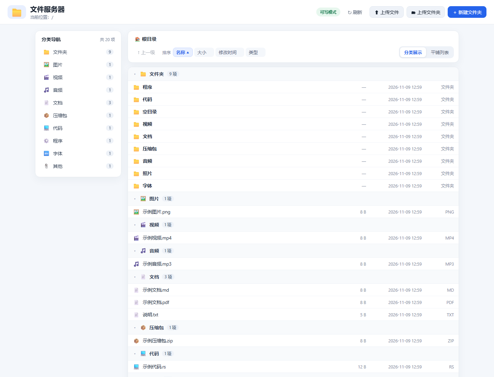

# 轻型文件服务器

> 基于 Tauri 2 + Rust 的 Windows 桌面 FTP/HTTP 文件服务器，支持匿名访问与 Portable 单文件构建。

一个基于 Tauri 2 + Rust 的 Windows 桌面文件服务器，提供：

- FTP 服务：匿名登录、PASV/EPSV 被动模式、目录浏览、下载
- 可选匿名写入：上传、创建目录、删除文件/空目录，默认关闭
- HTTP 服务：浏览器文件浏览页，支持按名称/大小/修改时间/类型排序、按后缀自动分类展示
- HTTP 上传：浏览器内上传文件、上传整个文件夹（保留子目录结构）、拖拽上传、新建文件夹
- 全中文桌面界面
- 共享目录可通过系统文件夹选择器设置
- FTP / HTTP 端口可配置
- 可配置 FTP 被动端口范围
- 可指定 FTP PASV 对外 IPv4 地址，也可自动检测
- 运行日志、状态和访问地址实时显示
- 配置自动保存到当前用户配置目录
- 附带 PowerShell / BAT 构建脚本

## 项目结构

```text
.
├─src/                    # Tauri 前端（原生 HTML/CSS/JS）
├─src-tauri/
│  ├─src/lib.rs           # 配置、FTP 服务、Tauri commands 与启动流程
│  ├─src/http.rs          # HTTP 服务：浏览页 API、上传、新建文件夹
│  ├─src/http_tests.rs    # HTTP 服务端到端测试（cargo test）
│  ├─src/webui/           # HTTP 浏览页静态资源（内嵌进二进制）
│  │  ├─index.html
│  │  ├─app.css
│  │  ├─app.js
│  │  └─README.md         # 浏览页与后端接口契约
│  ├─src/main.rs          # Tauri 入口
│  ├─tauri.conf.json      # Tauri 配置
│  ├─capabilities/        # Tauri 2 权限
│  └─Cargo.toml           # Rust 依赖
├─build.ps1               # Windows 发布构建
├─build.bat               # Windows 发布构建（双击）
├─dev.ps1                 # 开发调试
├─LICENSE                 # MIT 开源许可证
├─.gitignore              # Git 忽略规则（依赖、构建产物、日志）
└─.gitattributes          # 换行符与二进制文件规则
```

## 版本控制（Git）

本仓库使用 Git 管理，默认分支为 `main`。依赖目录和构建产物不会进入版本库，日常开发直接提交源码即可：

```powershell
git status                 # 查看改动
git add .                  # 暂存改动
git commit -m "说明本次修改"
git log --oneline          # 查看提交历史
```

`.gitignore` 会忽略以下路径，无需手动处理：

```text
node_modules/              # npm 依赖
dist/                      # Vite 前端构建产物
portable/                  # Portable 单文件构建产物
src-tauri/target/          # Rust 编译产物
src-tauri/gen/schemas/     # Tauri 自动生成的权限 schema
*.log                      # 日志与临时文件
```

若要确认某个文件为什么被忽略，可执行 `git check-ignore -v <路径>`。首次克隆后仍需执行 `npm install` 下载前端依赖，Rust 依赖由 Cargo 在构建时自动下载。

如需备份或协作，可把仓库推送到远程（GitHub / Gitee 等）：

```powershell
git remote add origin <远程仓库地址>
git push -u origin main
```

## Windows 构建

建议在 PowerShell 中执行：

```powershell
Set-ExecutionPolicy -Scope Process Bypass
.\build.ps1
```

或者双击 `build.bat`。

Tauri 官方目前要求 Windows 开发环境包含 Microsoft C++ Build Tools 和 WebView2，并使用 Rust；本项目不依赖 Node 前端框架，使用 Vite 仅负责前端打包。

发布包生成到：

```text
src-tauri\target\release\bundle\nsis\
src-tauri\target\release\bundle\msi\
```

## 开发运行

```powershell
.\dev.ps1
```

首次运行需要下载 npm/Rust 依赖，因此必须可以访问对应包仓库。

## FTP 使用

默认配置：

```text
FTP：21
HTTP：8088
被动端口：50000-50100
匿名账号：anonymous
匿名密码：任意
```

FTP 客户端填写：

```text
主机：运行服务器电脑的 IP
端口：21
用户名：anonymous
密码：任意内容
传输模式：被动（PASV）
```

Windows 同机测试可以使用：

```text
ftp://127.0.0.1:21/
http://127.0.0.1:8088/
```

局域网访问请使用界面中的 IPv4 地址。

> Windows 资源管理器打开 `ftp://...` 提示“打开 FTP 服务器上的文件夹时发生错误”时，通常是被动模式数据连接没连上：服务端会在 PASV 应答里使用客户端实际连入的网卡地址（本机访问即 `127.0.0.1`，不会误用 VPN/虚拟网卡的地址）；若仍失败，请在桌面端把「对外地址」明确填成本机局域网 IPv4，并确认 Windows 防火墙放行了 FTP 被动端口范围（默认 TCP 50000-50100）。

## HTTP 浏览页

浏览器打开：

```text
http://127.0.0.1:8088/
```

页面功能：

- **排序**：按名称、大小、修改时间、后缀类型排序，再次点击同一列可切换升序/降序；文件夹始终排在文件前。
- **按后缀分类**：文件按扩展名自动归入「文件夹、图片、视频、音频、文档、压缩包、代码、程序、字体、其他」分组并显示数量，可切换「分类展示 / 平铺列表」。
- **上传文件 / 上传文件夹**：点击按钮或直接把文件、文件夹拖入页面；文件夹上传会保留原有子目录结构。
- **新建文件夹**：在页面顶部按钮中创建当前目录下的新文件夹。
- **下载与导航**：点击文件名下载，目录可逐级进入，面包屑和「上一级」可快速返回。

上传、新建文件夹受桌面端「允许匿名上传、创建和删除文件」开关控制；关闭时浏览页为只读模式，只能浏览和下载。

浏览页通过以下 JSON 接口工作（契约详见 `src-tauri/src/webui/README.md`）：

| 接口 | 说明 |
| --- | --- |
| `GET /_api/list?dir=<目录>` | 列出目录条目（名称、路径、大小、修改时间、后缀、是否目录） |
| `POST /_api/upload?dir=<目录>&path=<相对路径>` | 上传单个文件，请求体为文件原始内容，后端流式写盘 |
| `POST /_api/mkdir?dir=<目录>&name=<名称>` | 新建文件夹 |



## 测试

HTTP 服务的目录列表、静态资源、文件下载、上传、新建文件夹、写权限开关与路径越界防护都有端到端测试：

```powershell
cd src-tauri
cargo test --lib
```

测试会在系统临时目录中启动内嵌的 HTTP 服务并走真实 TCP 请求，不需要打开桌面窗口或联网。

## Windows 防火墙

如果局域网客户端无法访问，至少需要允许：

- FTP 控制端口，例如 TCP 21
- HTTP 端口，例如 TCP 8088
- FTP 被动端口范围，例如 TCP 50000-50100

可以使用“Windows Defender 防火墙 → 高级设置 → 入站规则”创建对应 TCP 规则。

## 注意

1. 匿名 FTP 是明文协议，用户名、密码和文件内容不会经过 TLS 加密。
2. HTTP 版本默认也没有启用 HTTPS。
3. 匿名写入默认关闭。开启后，匿名用户可以上传文件、创建目录、删除文件和空目录，HTTP 浏览页也会显示上传/新建文件夹控件，请只在可信局域网使用。
4. 程序会阻止 FTP/HTTP 路径越过共享根目录；对于现有符号链接，也会检查其解析后的目标是否仍在共享根目录内。
5. 当前 FTP 实现以常见客户端操作为目标，支持 `USER/PASS/PWD/CWD/CDUP/LIST/NLST/MLSD/RETR/STOR/DELE/MKD/RMD/SIZE/PASV/EPSV/TYPE/FEAT/QUIT` 等常用命令，不提供 FTPS。

## 版本与环境

项目采用 Tauri 2；前端为原生 JavaScript + Vite，后端为 Rust/Tokio + Axum。

Tauri 官方文档：
https://v2.tauri.app/zh-cn/

Tauri Windows 前置要求：
https://v2.tauri.app/zh-cn/start/prerequisites/

### Windows 图标
项目包含 `src-tauri/icons/icon.ico`。Windows 构建需要该 ICO 文件，Tauri 配置也已显式引用。

## 启动服务模式

桌面界面中的“启动服务”可选择：

- FTP + HTTP：同时启动两个服务
- 仅 FTP：只监听 FTP 端口
- 仅 HTTP：只监听 HTTP 端口

未启用的服务不会占用端口；对应访问地址会显示“未启动”。配置会自动保存。

## Portable 单文件

执行：

```powershell
.\build-portable.ps1
```

或者：

```text
build-portable.bat
```

生成：

```text
portable\轻型文件服务器.exe
```

这是不需要安装程序的单个应用 EXE，可直接复制到其他 Windows 电脑运行。由于 Tauri 使用 WebView2，目标电脑仍需要可用的 WebView2 Runtime；该 Portable EXE 本身不会把 WebView2 Runtime 静态塞进一个文件中。

## 许可证

本项目采用 [MIT 许可证](LICENSE) 发布，Copyright (c) 2026 chai。
